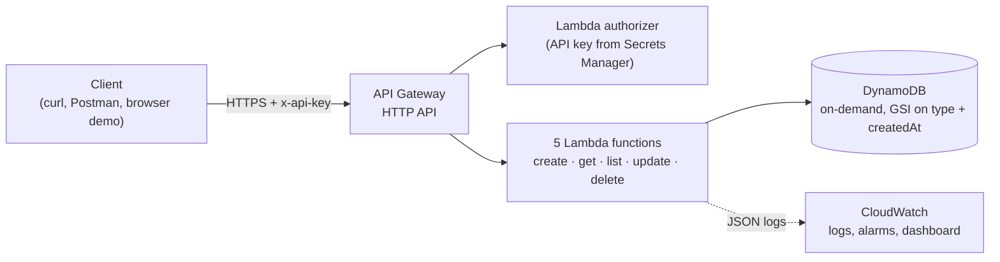

# Serverless Device Registry API

[](https://github.com/Joun-Mikhail/device-registry-serverless-api/actions/workflows/ci.yml)
[](LICENSE)

A REST API for registering and managing IoT devices (sensors, actuators, gateways, controllers), built on AWS Lambda, API Gateway (HTTP API) and DynamoDB. The infrastructure is defined with AWS SAM and deployed from GitHub Actions using OIDC, so no AWS keys are stored in the repository.

- [Browser demo](https://joun-mikhail.github.io/device-registry-serverless-api/app.html) — the device manager UI. By default it runs entirely in the page with the same validation rules as the API, and it can be pointed at a deployed API.
- [Project site](https://joun-mikhail.github.io/device-registry-serverless-api/) — API reference (OpenAPI) and the coverage report from the latest CI run.

**Status:** the stack is written for a single `dev` environment in `eu-central-1` and deploys manually from GitHub Actions. There is no public endpoint yet. The tests run against a mocked DynamoDB ([moto](https://github.com/getmoto/moto)), and the API can be run locally without an AWS account.

## Architecture



- **One Lambda per endpoint**, each with its own IAM policy. Read functions can't write.
- **Layers inside each function:** handler → validation → repository → model. Validation runs before any database call, and errors come back in one format (`400 VALIDATION_ERROR`, `404 NOT_FOUND`, `409 CONFLICT`, `500 INTERNAL_ERROR`) without stack traces.
- **Listing** uses cursor pagination (`limit` + `nextToken`). Filtering by `type` is a GSI query. The unfiltered list is still a paginated scan.
- **Logging:** every request writes one JSON log line with a request ID, route, status and latency, so it can be searched in CloudWatch Logs Insights.

The design decisions and their trade-offs are written up as short ADRs in [`docs/decisions/`](docs/decisions/), for example [one Lambda per endpoint](docs/decisions/0001-one-lambda-per-endpoint.md), [SAM over CDK/Terraform](docs/decisions/0002-sam-over-cdk-and-terraform.md) and [API key instead of Cognito](docs/decisions/0007-api-key-over-cognito.md). More diagrams are in [`docs/architecture.md`](docs/architecture.md).

## API

All routes require an `x-api-key` header. Requests without a valid key are rejected by the authorizer before they reach a handler.

| Method | Path | Description |
| --- | --- | --- |
| `POST` | `/devices` | Create a device → `201` |
| `GET` | `/devices` | List devices. Query params: `limit` (1–100, default 25), `nextToken`, `type` |
| `GET` | `/devices/{deviceId}` | Get one device → `200` or `404` |
| `PATCH` | `/devices/{deviceId}` | Partial update, only the fields sent are changed |
| `DELETE` | `/devices/{deviceId}` | Delete a device → `200` or `404` |

Example:

```bash
curl -X POST "$API_URL/devices" \
  -H "x-api-key: $API_KEY" -H "Content-Type: application/json" \
  -d '{"name": "Temp Sensor A", "type": "sensor", "location": "Floor 2"}'
```

```json
{
  "deviceId": "a3f1c2d4-8b5e-4f9a-bc12-d3e4f5a6b7c8",
  "name": "Temp Sensor A",
  "type": "sensor",
  "status": "active",
  "location": "Floor 2",
  "createdAt": "2026-03-01T10:30:00+00:00",
  "updatedAt": "2026-03-01T10:30:00+00:00"
}
```

**Device fields**

| Field | Rules |
| --- | --- |
| `name` | Required, 1–100 characters, trimmed |
| `type` | Required: `sensor`, `actuator`, `gateway` or `controller` |
| `status` | Optional: `active` (default), `inactive` or `maintenance` |
| `location` | Optional, up to 200 characters |
| `metadata` | Optional JSON object |
| `deviceId`, `createdAt`, `updatedAt` | Set by the service |

Unknown fields in a `PATCH` return `400`. The full contract is in [`docs/openapi.yaml`](docs/openapi.yaml), and there is a [Postman collection](docs/postman/device-registry.postman_collection.json).

## Run it locally

No AWS account needed. An in-memory DynamoDB replaces the real one, and the handlers are the same code that runs in Lambda.

```bash
git clone https://github.com/Joun-Mikhail/device-registry-serverless-api.git
cd device-registry-serverless-api
python -m venv .venv && source .venv/bin/activate
pip install -r requirements-dev.txt

python scripts/local_server.py --seed --api-key "demo-key"
curl -H "x-api-key: demo-key" http://127.0.0.1:8000/devices
```

## Tests

```bash
pytest                             # unit tests + coverage (fails below 91%)
pytest tests/contract --no-cov     # responses checked against docs/openapi.yaml
API_BASE_URL=https://... pytest tests/integration   # only against a deployed stack
```

- **Unit tests (112):** validation, handlers, DynamoDB repository (moto), pagination, logging and the authorizer.
- **Contract tests (13):** the OpenAPI file is valid, and every handler response matches its schema.
- **Integration tests (10):** skipped unless `API_BASE_URL` points at a deployed stack.

Current unit-test coverage is about 92%. The coverage report from the latest CI run is published on the [project site](https://joun-mikhail.github.io/device-registry-serverless-api/coverage/).

## CI/CD

- **`ci.yml`** runs on every push and pull request: unit tests with the 91% coverage gate, and `ruff`.
- **`deploy.yml`** runs the unit and contract tests and `detect-secrets`. Its deploy job (`sam build` + `sam deploy`) only runs when started manually, and it signs in to AWS through GitHub OIDC instead of stored keys.
- **`pages.yml`** publishes the project site and the coverage report.

Local pre-commit hooks (`ruff`, `detect-secrets`, YAML and whitespace checks) are in [`.pre-commit-config.yaml`](.pre-commit-config.yaml).

## Deploy to AWS

1. Create the GitHub OIDC provider and deploy role once, as described in [`docs/oidc-setup.md`](docs/oidc-setup.md), and save the role ARN as the `AWS_DEPLOY_ROLE_ARN` repository secret.
2. Run **Actions → Deploy → Run workflow**, or deploy from your machine:

   ```bash
   sam build && sam deploy --guided   # stack: device-registry-dev, region: eu-central-1
   ```

3. Get the API key from Secrets Manager (the ARN is in the stack output `ApiKeySecretArn`) and call the API URL from the stack outputs.

To remove everything: `sam delete --stack-name device-registry-dev`. The DynamoDB table has `DeletionPolicy: Retain`, so delete it by hand if you don't need the data.

## Security notes

- Every route goes through a Lambda authorizer that compares the `x-api-key` header with a key generated at deploy time and kept in Secrets Manager. The comparison is constant-time, and the authorizer denies the request if anything goes wrong.
- IAM permissions are set per function.
- Input is validated before any database call, and internal errors are logged but never returned to the caller.

## Known limitations

- **No public deployment yet.** Everything is tested locally against a mocked DynamoDB.
- **One shared API key** for all callers, so requests can't be traced to a specific client and revoking access means rotating the key for everyone. Per-client keys or a JWT authorizer would fix this.
- **CORS allows any origin** (`*`). That's fine for the `dev` stage, but it needs to be restricted before going public.
- **The unfiltered list is a table scan.** It is paginated, but it still reads the whole table over many requests.
- The CloudWatch alarms and dashboard in `template.yaml` have not been tested against a live stack yet.

## Next steps

1. Deploy the `dev` stack and add the live URL to this README.
2. Per-client API keys or a JWT authorizer.
3. Replace the unfiltered scan with an index.
4. Restrict CORS to known origins.

## License

[MIT](LICENSE) © 2026 Joun Mikhail
